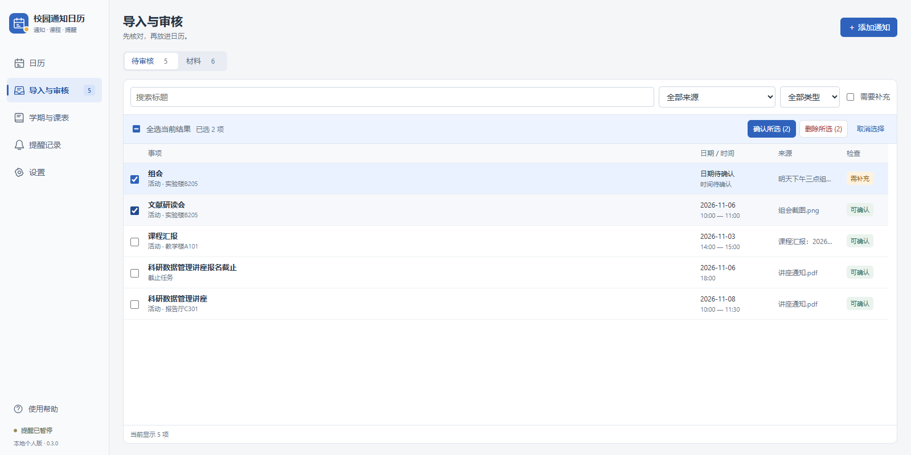

# 校园通知日历助手

把分散的通知整理成日历和课表，核对后再入历，并通过邮件提醒。个人 Windows 桌面应用，当前版本 **0.3.0**。


## 能做什么

- 导入文字、TXT、PNG/JPEG/WebP、PDF，以及公开网页链接；支持公众号文章、H5和图片页面。遇到验证或登录时需自行补充正文或截图。
- DeepSeek提取活动、截止任务、地点和行动要求，先生成候选，由用户核对后确认；支持筛选、批量确认和批量删除。
- 周、月、列表日历；有限学期内按教学周、单双周、节次展开课程，支持单次调课和停课。
- 同一事项按后上传材料明确提供的字段更新，保留未提及内容和来源提示；不同日期的同名活动默认独立。
- SMTP邮件提醒、托盘后台运行、发送记录、备份和恢复。



## 安装使用

Windows 11 x64。从仓库右侧 [Releases](https://github.com/Makashibata02/campus-notice-calendar/releases/latest) 获取 `CampusCalendar-Setup-0.3.0-x64.exe`；使用者无需安装Node或Python。当前源码包本身不包含安装程序。

1. 在设置中填写并保存DeepSeek Key。
2. 填写SMTP主机、端口、TLS选项、发件邮箱、授权码和收件邮箱，保存并测试。QQ邮箱可使用 `smtp.qq.com`、465、隐式TLS；授权码来自发件邮箱，收件邮箱无需开启SMTP。
3. 添加通知，在材料页识别，在待审核列表对照原通知，确认后进入日历。
4. 重复课程先设置学期与节次。关闭窗口会收起到托盘；完全退出使用托盘菜单。

详细图文说明：[使用说明.html](使用说明.html)（下载后可离线打开）；应用内入口：**设置 → 使用帮助**。Key和邮箱授权码无需写进源码或发给维护者。

## 输入范围

每批最多10个文件；图片/TXT单个最多10MB，PDF最多50MB。PDF支持逐页取文字，扫描页可选页转图，每次最多10页。文字最多10万字符，网页截图最多10屏，超过限制需拆分。Word/Excel/PPT/HEIC先转成PDF、图片或文字。链接只读取内容，不自动报名，不处理二维码、小程序、登录后内容或多步骤交互。

## 开发

构建机需要Node 24+、npm；SQLite原生依赖没有可用预编译时还需要Python与Visual Studio C++构建工具。

```powershell
npm ci
npm run rebuild
npm run typecheck
npm test
npm run build
npm start
npm run pack
```

安装包生成在 `release/`。`npm run dev`只预览前端，完整桌面功能使用构建后的 `npm start`。重复安装在应用外部的用户目录保留资料，升级前仍建议在设置中备份。

目录、检查方法及复现边界见 [开发与验证](docs/DEVELOPMENT.md)。`materials/index.html`提供32份合成输入及参考结果；reference不发送给模型。

## 数据与边界

资料存于本机用户目录；所选识别内容会发送到模型，链接读取还会访问原网站，并可能使用DeepSeek网页读取接口。API Key和邮箱授权码由主进程通过Electron safeStorage保存；普通备份不包含凭据。详见 [数据说明](docs/PRIVACY.md)。

关机、休眠或完全退出期间不能发信。SMTP已接收不保证进入收件箱。缺少基准日期时不能根据上传日期猜“明天”。重要日期和AI结果应人工核对。

47项确定性程序检查通过，开发环境已完成构建。历史小样本文字、图片、PDF真实识别及用户确认收信，不能代表总体准确率；干净Windows电脑和真实休眠唤醒仍待补测，安装包未签名。见 [验证范围](docs/VALIDATION.md)。

## 许可与参考

源码采用 [MIT](LICENSE)。交互参考Todue和qq-live-digest，独立实现，未复制其代码；依赖、工具及外部服务见 [THIRD_PARTY.md](THIRD_PARTY.md) 和 [DEPENDENCY_LICENSES.txt](DEPENDENCY_LICENSES.txt)。Codex辅助开发、测试与文稿，使用者仍须检查运行结果。
